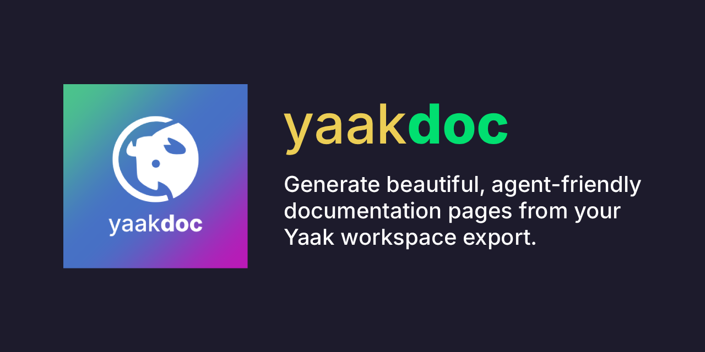

# yaakdoc

Static, themable, and LLM-friendly API documentation generated from [Yaak](https://yaak.app) exports.

**SEE A LIVE DEMO HERE: https://yaakdoc-demo.vercel.app**

```sh
npx yaakdoc
```

Run it next to a Yaak export (`yaak.json`) and your docs are served at `http://localhost:4000`. `npx yaakdoc build` writes a static site to `dist/` that you can host anywhere.

- **Rendered on the server.** Every page is prerendered HTML. The docs are readable without JavaScript, and only small interactive "islands" (tabs, copy buttons, the color mode toggle) hydrate on the client.
- **Zero config.** The export is auto-detected, and the workspace name, description and environment come from Yaak. Add an optional [`yaakdoc.config.json`](#configuration) for branding and options.
- **Themable.** Unstyled React components (`@yaakdoc/react`), a component override system and a free layout. The default theme, [Kiseki](packages/theme-kiseki), uses Tailwind CSS v4 and shadcn/ui, with light and dark mode and syntax highlighting.
- **Ejectable.** `yaakdoc eject` copies the theme into your project, where you can change anything.
- **LLM friendly.** It generates `llms.txt`, `llms-full.txt` and a Markdown version of every page. Kiseki adds "Copy page", "View as Markdown" and "Open in ChatGPT/Claude" actions.
- **Code examples.** Each request gets examples in cURL, JavaScript, Python, Go, grpcurl and wscat. The generators are pluggable.

## Getting started

There are multiple ways to generate a documentation site from your Yaak workspace.

## Yaak plugin

The [yaakdoc plugin for Yaak](packages/yaak-plugin) builds the docs without leaving Yaak. Install `@yaakdoc/yaakdoc` from Yaak's plugin registry (**Settings → Plugins**), then use the workspace menu:

- **Build docs with yaakdoc...** exports the workspace, lets you set every config option in a form, and builds the static site into a folder you choose.
- **Save as yaakdoc project...** writes `yaakdoc.json` and `yaakdoc.config.json` into a folder, ready to commit and build in CI.

With Kiseki, the default theme, there's nothing else to install: the plugin bundles yaakdoc and a precompiled Kiseki and builds inside Yaak. Other themes are built with the yaakdoc CLI, so they need Node.js ≥ 20.19 with npm. Install the [Yaak CLI](https://github.com/mountain-loop/yaak) too, so environments and gRPC/WebSocket requests are included in the docs.

## CLI

1. In Yaak, export your workspace (**Settings (cog in the top right corner) → Export Data**) and save it as `yaak.json`.
2. Run `npx yaakdoc` in the same folder to start the dev server. It reloads when the export changes.
3. Run `npx yaakdoc build` to produce a static site in `dist/`.

To keep yaakdoc as a project dependency:

```sh
npm i -D yaakdoc
npx yaakdoc init     # creates yaakdoc.config.json (with editor autocomplete)
```

### Commands

| Command | Description |
| --- | --- |
| `yaakdoc [export]` | Same as `yaakdoc dev`. |
| `yaakdoc dev [export]` | Dev server with SSR, live reload and HMR. Options: `--port/-p`, `--host`, `--open/-o`, `--no-watch`. |
| `yaakdoc build [export]` | Builds the static site. Options: `--out-dir/-o`. |
| `yaakdoc preview` | Serves the built site locally. Options: `--port/-p`, `--host`, `--out-dir`, `--open`. |
| `yaakdoc init` | Interactive setup that writes `yaakdoc.config.json`. Options: `--yes/-y`, `--force`. |
| `yaakdoc eject` | Copies the current theme to `./theme` and switches the config to it. Options: `--out`, `--force`. |

`dev` and `build` also accept `--config/-c`, `--theme/-t`, `--pages single|per-request`, `--base`, `--environment/-e` and `--workspace/-w`. Flags take precedence over the config file.

For anything else, `--overrides` takes a JSON file or inline JSON with any [config](#configuration) values. It's deep-merged over the config file, and explicit flags still win over it. Paths in it are relative to the current directory.

```sh
npx yaakdoc build --overrides '{"branding":{"title":"Staging API"},"runInYaak":false}'
```

When no export is passed (as an argument or `export` in the config), yaakdoc uses `yaakdoc.json` or, failing that, `yaak.json` from the current directory.

## Configuration

Everything is optional. `yaakdoc.config.json` (`.jsonc`, `.ts` and `.js` also work) looks like this:

```jsonc
{
  "$schema": "./node_modules/yaakdoc/config.schema.json",
  "export": "./yaak.json",
  "theme": "kiseki", // short name, npm package, or local path (e.g. "./theme")
  "themeOptions": {
    "codePanel": "right" // theme-specific configuration
  },
  "workspace": "Acme Store API", // when the export has several workspaces
  "environment": "Production", // used to resolve variables in examples; false = none
  "environments": "public", // adds an environment switcher: "public" or a list of names/ids
  "pages": "single", // "single" (one page, anchors) | "per-request"
  "base": "/", // e.g. "/docs/" when hosted in a subfolder
  "outDir": "dist",
  "server": {
    "port": 4000,
    "host": false,
    "open": false
  },
  "branding": {
    "title": "Acme API",
    "description": "Manage your Acme store.",
    "url": "https://docs.acme.dev", // enables canonical URLs, sitemap.xml and absolute llms.txt links
    "logo": {
      "light": "./logo.svg",
      "dark": "./logo-dark.svg"
    },
    "favicon": "./favicon.svg",
    "colors": {
      "primary": "#0f766e",
      "dark": {
        "primary": "#5eead4"
      }
    },
    "fonts": {
      "sans": "\"Inter\", sans-serif",
      "stylesheet": "https://fonts.googleapis.com/css2?family=Inter"
    },
    "links": [
      {
        "label": "Status",
        "href": "https://status.acme.dev"
      }
    ],
    "footer": "© Acme Inc. [Contact us](mailto:api@acme.dev)",
    "defaultColorMode": "system",
    "colorModeToggle": true,
    "customCss": "./brand.css"
  },
  "snippets": ["curl", "javascript", "python", "go", "grpcurl", "wscat"],
  "runInYaak": true, // or { "name": "Acme API", "url": "https://.../openapi.json" }
  "llms": {
    "enabled": true,
    "full": true,
    "copyButton": true,
    "openIn": ["chatgpt", "claude"]
  },
  "variables": {
    "resolve": true,
    "show": true,
    "hide": ["token", "secret", "password"]
  },
  "filter": {
    "include": [],
    "exclude": ["internal/**"]
  },
  "head": [
    {
      "tag": "script",
      "attrs": {
        "src": "https://plausible.io/js/script.js",
        "defer": true
      }
    }
  ]
}
```

The full reference is the JSON schema at [`config.schema.json`](https://unpkg.com/yaakdoc/config.schema.json) (published with the `yaakdoc` package), which is generated from the [Zod schema](packages/config/src/schema.ts). Some details:

- **Secrets.** yaakdoc never inlines a variable whose value uses a template function (such as `secure(...)`) or whose name matches `variables.hide`. Those show up as `{{name}}` placeholders in the examples and as `<redacted>` in the tables. Private environments are only used when you select one explicitly.
- **Environment switcher.** With `environments`, the examples and the variables table are prerendered for each listed environment, and readers switch between them without a reload. Their choice is remembered.
- **Run in Yaak.** `runInYaak` adds a button that opens [Yaak](https://yaak.app/button/new) and imports the API. yaakdoc publishes a sanitized copy of the export at `<base>yaak.json`. The copy contains only the documented workspace and requests, has no private environments, blanks secret variables, headers and auth fields, and removes `secure(...)` values. Set `runInYaak.url` to link to a spec hosted elsewhere instead. Set `branding.url` so the link is absolute in the HTML; otherwise it's made absolute in the browser.
- **`public/`.** Files in a `public/` folder next to the config are copied to the site root as-is.
- **Branding colors.** These are exposed to themes as CSS custom properties (`--yd-color-primary`, `--yd-font-sans`, ...).

## Example responses

Document responses by adding `response` code blocks to a request's description in Yaak. Add an HTTP status code to show several responses (success, errors, ...):

````md
Retrieve a single product by its id.

```response:200
{ "id": "prod_123", "name": "Running shoes" }
```

```response:404
{ "error": "not_found" }
```
````

- **Removed from the description.** Response blocks are shown as tabbed, syntax-highlighted examples labeled by status (`200 OK`, `404 Not Found`). They're also included in the Markdown and `llms.txt` output.
- **Without a status code.** A plain `response` block is labeled "Response".
- **Language.** JSON, XML and HTML are detected automatically. To set it explicitly, add it after the status, e.g. `response:200 yaml`.
- **Empty bodies.** A block with no content (e.g. `response:204`) shows "No response body".

## LLM-friendly output

When `llms.enabled` is on (the default), every site includes:

- `/llms.txt`, following the [llms.txt](https://llmstxt.org) format, with links to every endpoint's Markdown.
- `/llms-full.txt`, the complete documentation in a single Markdown file.
- A Markdown version of every page: append `.md` to a request or folder path, e.g. `/products/get-a-product.md`. The dev server also returns Markdown for requests with `Accept: text/markdown`.
- A `<link rel="alternate" type="text/markdown">` tag on every page, and "Copy page" and "Open in ChatGPT/Claude" actions in the default theme.

## Themes

A theme is a small manifest plus React components that Vite renders on the server:

```ts
// theme.ts
import { defineTheme } from "@yaakdoc/react/theme";

export default defineTheme({
  name: "my-theme",
  entry: "./src/entry.tsx", // default-exports { Layout, components?, Head? }
  client: "./src/client.ts", // default-exports the islands to hydrate
  styles: ["./src/styles.css"],
  vitePlugins: async () => [(await import("@tailwindcss/vite")).default()],
});
```

Set `"theme": "./my-theme"` to use a local theme. To publish one, name the package `yaakdoc-theme-<name>`; users can then refer to it by its short name. See the [theme authoring guide](packages/react/README.md) for the components, hooks, override system and islands, and [Kiseki](packages/theme-kiseki) as a complete example.

The quickest way to customize is `npx yaakdoc eject`. The ejected theme's dependencies are provided by yaakdoc, so it works without installing anything.

## Packages

| Package | Description |
| --- | --- |
| [`yaakdoc`](packages/yaakdoc) | CLI, Node API (`createDevServer`, `build`, `preview`, `eject`, `init`) and the Vite-based engine. |
| [`@yaakdoc/core`](packages/core) | Parses Yaak exports (all schema versions), normalizes them into a documentation model, resolves templates and variables. |
| [`@yaakdoc/config`](packages/config) | The config schema (Zod), `defineConfig`, loader and JSON schema. |
| [`@yaakdoc/snippets`](packages/snippets) | Code example generators and `defineSnippet`. |
| [`@yaakdoc/markdown`](packages/markdown) | Markdown rendering of requests and folders, `llms.txt` and `llms-full.txt`. |
| [`@yaakdoc/react`](packages/react) | Unstyled components, hooks, component overrides, the island runtime and the theme contract. |
| [`@yaakdoc/theme-kiseki`](packages/theme-kiseki) | The default theme. |
| [`@yaakdoc/yaakdoc`](packages/yaak-plugin) | The Yaak plugin (published to Yaak's plugin registry, not npm). |

## How it works

```
yaak.json ─▶ @yaakdoc/core ─▶ prepareDocument ─▶ PreparedDocument ─┬─▶ theme (React SSR via Vite) ─▶ HTML
              normalize         + Shiki, Markdown,                  ├─▶ @yaakdoc/markdown ─▶ .md, llms.txt
                                + snippets, routes                  └─▶ islands (hydrated) ─▶ client JS
```

- **Dev server.** Vite runs in middleware mode, and each request is server-rendered through Vite's SSR module runner. Theme and CSS changes hot-reload. Changes to the export or config rebuild the document and reload the page.
- **Build.** Vite builds the client islands and CSS, then bundles the SSR entry. Every route is prerendered with `react-dom/static`, and the Markdown and `llms.txt` files are written alongside.
- **Highlighting and Markdown.** Shiki and the descriptions' Markdown are rendered at build time, so highlighting ships no client JS. Dual themes switch with CSS variables.

## Development

```sh
pnpm install
pnpm build            # turbo: builds all packages
pnpm test             # vitest in every package
pnpm check-types
pnpm lint             # biome
pnpm --filter demo dev        # run the demo docs (apps/demo)
pnpm --filter demo test:e2e   # Playwright end-to-end tests
```

Releases are managed with [Changesets](https://github.com/changesets/changesets): run `pnpm changeset`, then `pnpm version-packages` and `pnpm release`.

## License

[MIT](LICENSE) © József Sallai
