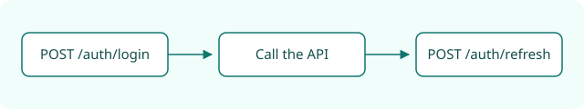

Every request needs an access token, sent in the `Authorization` header:

```http
GET ${[ base_url ]}/products
Authorization: Bearer <token>
```



## Logging in

Call `POST /auth/login` with your email and password. The response contains an `access_token` that is valid for one hour, and a `refresh_token`.

## Refreshing

Before the access token expires, exchange the refresh token for a new pair with `POST /auth/refresh`. Never share either token, and never commit them to version control.

Back to the [Quickstart](../quickstart.md#1-get-a-token).
